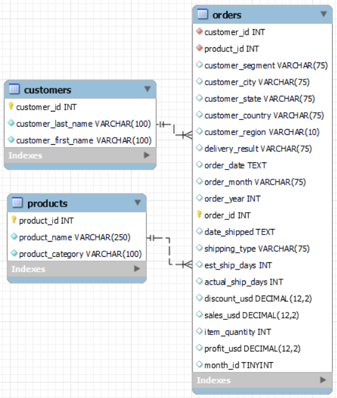
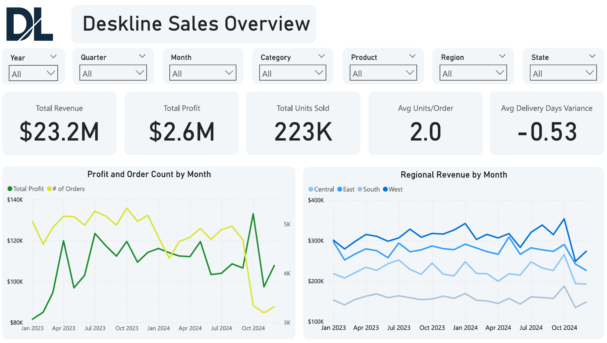
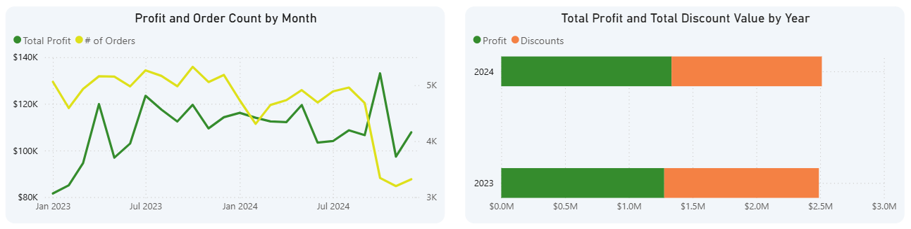
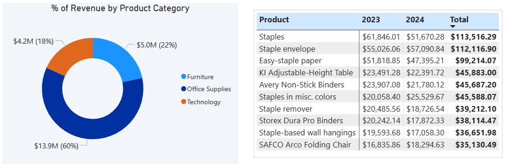
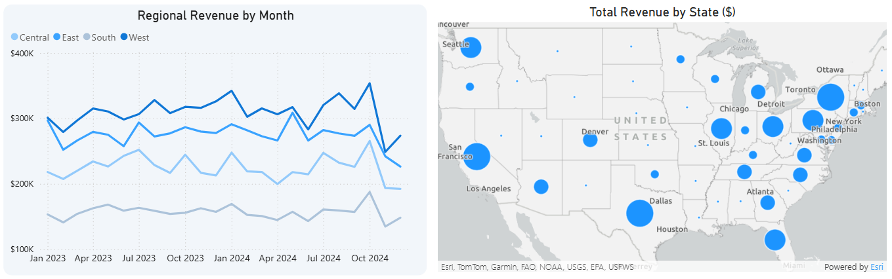
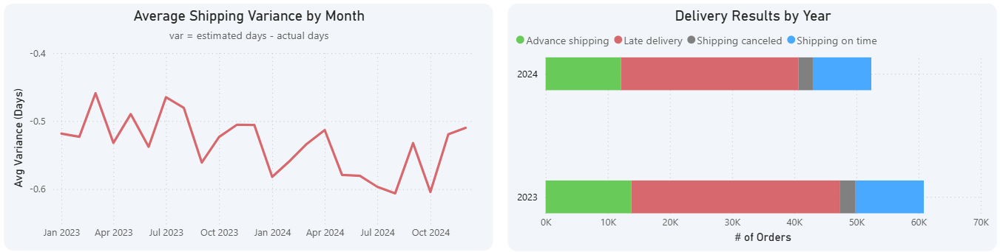

# **Deskline E-Commerce Sales Analysis**

## **Project Background**
Deskline is a U.S.-based e-commerce company that sells office equipment, furniture, and electronics. After two years in business, the company has collected substantial data pertaining to its sales, products, and customers. However, they are unsure of how to effectively store this information, or how to translate it into actionable insights. This project establishes a new relational database schema to support data organization and scalability, and analyzes that data to generate insights and provide recommendations for improving sales and operational performance. 

- To download an interactive Power BI dashboard, click [*here*]()
- To view the data cleaning process in Excel and SQL, click [*here*]()
- To view the SQL queries utilized to perform exploratory data analysis, click [*here*]()

## **Objectives**
1. Transform the current data source into a structured relational database schema.
2. Identify top-performing products and categories by revenue and profitability to guide inventory decisions.
3. Compare sales performance across regions and states to highlight geographic strengths.
4. Analyze shipping and delivery timeliness to identify opportunities to improve operational efficiency.

## **Data Overview**
The original dataset consisted of a single CSV file containing 21 columns and 113,271 records. To support data organization and scalability, the data was reorganized into a relational database with three tables: **customers**, **products**, and **orders**.

  

Certain customer-related variables (e.g., *customer_segment*, *customer_region*) are stored in the **orders** table, as these details may vary between orders from the same customer.

## **Executive Summary**
Deskline generated $11,631,365 in sales in 2023, and $11,534,726 in 2024, yielding a **<1% decrease in revenue** year-over-year. **Total profit increased** from $1,278,120 to $1,335,451 (+4.5%) over the same time frame. Revenue and profit remained stable, despite a **14% decrease in orders** in 2024, due to the average order price increasing from $191 to $220 (+15%). **Office Supplies was the best-selling product category**, accounting for 60% of total sales. Discounts were applied to over 94% of orders, averaging 11% of the average order value. **Total discounts represented 10% of revenue**, compared to an overall profit margin of only 11%.

California placed more orders and generated more revenue than any other state. All product categories and geographical regions yielded approximately **$23 of profit per order**. The average delivery time was 3.5 days, while the average order was promised in 2.9 days, producing an **unfavorable shipping variance of 21%** (~0.5 days). Deskline can improve sales and operational performance by prioritizing Office Supplies inventory management, reducing the frequency and value of discounts, and providing more accurate delivery time estimates.

  

## **Key Insights**
### **Sales Trends**
* Total orders decreased by 14% from 2023–2024. However, sales revenue declined by <1%, while total profit increased by 4.5%.
* Sales and profit stability, despite fewer orders, was driven by the average sales price per order increasing from $191 to $220.
* The Consumer segment accounted for 52% of total sales, followed by Corporate (30%) and Home Office (18%).
* Discounts were applied to over 94% of orders, averaging about $24 per order (11% of average order value). Deskline awarded $2,395,573 in total discounts across the two-year span.

  

### **Product & Category Performance**
* Office Supplies was the top-selling product category, accounting for over 60% of total sales.
* Staple and paper-related items were the best-selling individual products, accounting for six of the ten most-ordered items.
* All three product categories—Office Supplies, Furniture, and Technology—yielded an average profit of about $23 per order.

  

### **Regional Sales Performance**
* Deskline generated the most sales in the West region, totaling $7,420,991, or 32% of total revenue.
* The East region generated the second-highest sales (29%), followed by Central (23%) and South (16%).
* California led all states with 20% of total sales. The next-best performing state was New York, accounting for 11% of total sales.
* There was no discernable difference in profit between any of the regions, all about $23.

  

### **Shipping Timeliness**
* Deskline frequently overestimated its delivery capabilities. The average order took 3.5 days to reach the customer, compared to the average estimated shipping time of 2.9 days.
* Inaccurate shipping estimates resulted in 55% of orders being classified as late.
* Conversely, just 41% of orders were delivered on or before the estimated delivery date.
* Average shipping time and variance were nearly identical across all geographical regions, indicating no region-specific logistical issues.

  

## **Recommendations**
1. **Reduce discounts to improve profitability**. Decreasing the frequency of discounts from 94% to 70% of orders, and reducing the average discount from 11% to 9%, would yield an estimated $488,630 in additional profit in 2025 (+34%).
     * *Assuming order volume and average revenue per order remain constant from 2024.*
2. **Provide more accurate shipping time estimates.** Align promised delivery times with the actual average of 3.5 days to promote customer satisfaction and retention.
3. **Prioritize Office Supplies inventory management**. Maintain sufficient inventory of high-volume, profitable products, specifically staples and paper.

## **Questions for Stakeholders**
### **Discounts**
* Why are discounts applied so frequently?
* How heavily does the company rely on discounts for a competitive advantage?
* What is the discount scale for bulk orders?

### **Shipping and Deliveries**
* How many product distribution centers does the company own, and where are they located?
* Do customers have expedited shipping options?
* Does Deskline offer package tracking to customers?
* Are orders of certain sizes, or to certain customers, prioritized?

### **Customer Feedback**
* Are late shipments a common source of customer complaints?
* What are the other topics frequently mentioned in both positive and negative reviews? 